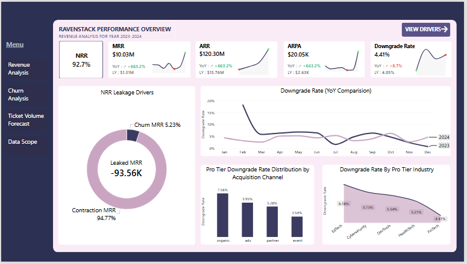
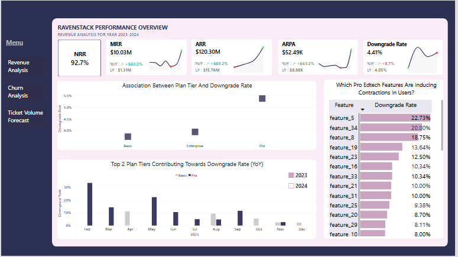
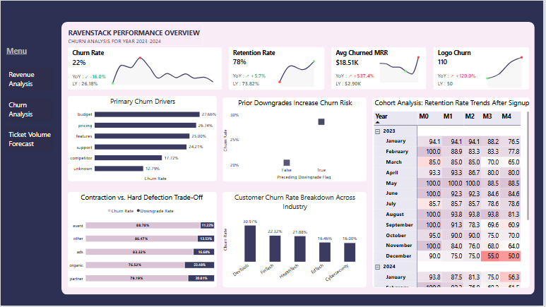

# RavenStack-Revenue-And-Churn-Analysis
### PostgreSQL + Power BI + Python 

## Project Overview
This project analyzes RavenStack's revenue performance, subscription downgrades, customer churn, and cohort retention to identify factors affecting revenue stability and customer growth.

The analysis focuses on revenue leakage, Pro-tier downgrades, pricing and product-related churn, acquisition channel performance, and declining customer retention among 2024 cohorts. The goal is to identify at-risk customer segments and recommend data-driven strategies to improve retention and sustainable revenue growth.

## Tools & Technologies
- PostgreSQL & pgadmin
- Python (pandas,scipy.stats,sqlalchemy)
- Power BI, DAX & Power Query

## Key Insights
- Revenue Retention: 2024 NRR was 92.71%, indicating 7.29% revenue contraction, with expansion MRR at $0.
- Pro-Tier Downgrades: Pro recorded the highest downgrade rate at 5.37%, with downgrades concentrated in specific periods and product features.
- Acquisition Channels: Partner referrals had the lowest churn rate at 14.61%, while Event leads recorded 30.21% churn despite a low 3.82% downgrade rate.
- Churn Drivers: Budget concerns (27.66%), pricing (26.74%), and missing or buggy features (25%) were the leading reported churn reasons.
- Industry Risk: DevTools recorded the highest churn, while Cybersecurity had the lowest at approximately 16%.
- Cohort Retention: 2024 cohorts experienced weaker retention than 2023 cohorts, with a significant drop-off around Month 3 and sharp early attrition in September 2024.

## Advanced Statistical Analysis
- A Chi-Square Test of Independence identified a statistically significant association between plan tier and downgrade behaviour (χ² = 6.28, p = 0.0433).
- Cramér's V = 0.035 indicated a very weak association between plan tier and downgrades.
- Other tested subscription characteristics were not statistically significant, suggesting that downgrade behaviour may involve additional factors not captured in the dataset.

## Dashboard Preview

### Revenue Analysis

### Revenue Drivers

### Churn Analysis

### Ticket Volume Forecast

## View Interactive Dashboard
[Download Dashboard](https://drive.google.com/file/d/1fdW4f_W0KhfuMfZaaetEGbbaJwyOSLul/view?usp=drive_link)

## Recommendations
- Improve Pro-tier onboarding and investigate features associated with high downgrade rates.
- Review pricing and introduce flexible add-ons to better align subscription costs with customer value.
- Strengthen customer support and prioritize the resolution of product bugs.
- Monitor previously downgraded accounts and introduce targeted retention campaigns before churn occurs.
- Investigate the Month 3 retention decline and improve onboarding and engagement during Month 2.
- Analyze successful retention practices in Cybersecurity and partner acquisition channels to identify strategies applicable to higher-churn segments.

## Dataset
https://www.kaggle.com/datasets/rivalytics/saas-subscription-and-churn-analytics-dataset

## Author
Faiza

> Note:

> RavenStack is a relatively small synthetic dataset, so observed relationships may not represent real-world customer behaviour. Results are treated as exploratory rather than causal.

> Due to file size, GitHub cannot preview the MS Word file. Please download the file to view the full report.

> If you like this project, feel free to star the repo!
